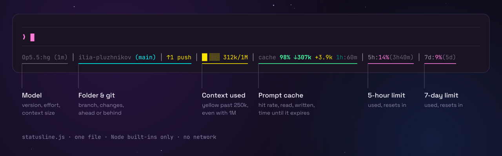
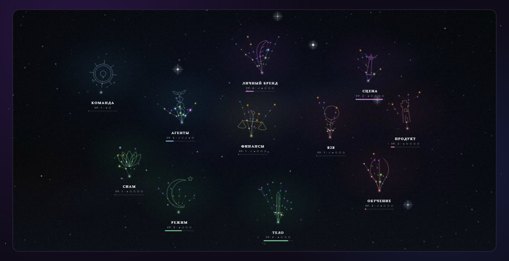
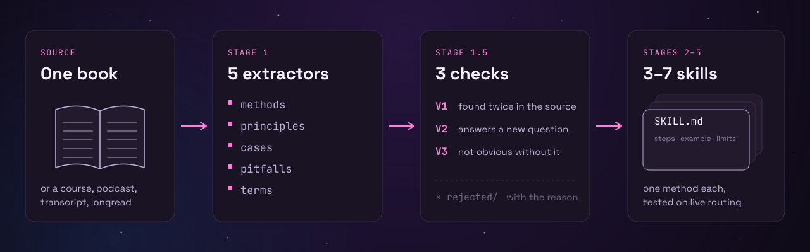

<a href="https://ilia-pro-ai.com"></a>

<a href="https://ilia-pro-ai.com"></a>&nbsp;&nbsp;<a href="https://www.youtube.com/@ilia-pluzhnikov"></a>&nbsp;&nbsp;<a href="https://t.me/iliaprovse"></a>

I started out as a product designer. For the last few years I have been teaching companies to work with AI, and building tools and products of my own along the way. Here are a few of them.

## claude-code-statusline

<a href="https://github.com/ilia-pluzhnikov/claude-code-statusline"></a>

One line at the bottom of Claude Code with what you would otherwise have to ask for: the model and effort level, the folder and its git state, how much context is gone, whether the prompt cache is still warm, and how far you are into the 5-hour and 7-day limits.

It is one file of Node.js with no dependencies and no network calls. Colour carries the urgency, so the shape of the line tells you something before you read a number. One rule I care about: past 250k tokens the context bar turns yellow even in a 1M window, because that is where answers start to slip and long-context pricing begins.

<a href="https://github.com/ilia-pluzhnikov/claude-code-statusline"></a>&nbsp;&nbsp;<a href="https://github.com/ilia-pluzhnikov/claude-code-statusline/stargazers"></a>&nbsp;&nbsp;<a href="https://github.com/ilia-pluzhnikov/claude-code-statusline/releases/latest"></a>

Install, in Claude Code:

```
/plugin marketplace add ilia-pluzhnikov/claude-code-statusline
/plugin install statusline-for-claude-code@ilia-pluzhnikov
/statusline-for-claude-code:setup
```

## Stargaze

<a href="https://github.com/ilia-pluzhnikov/stargaze"></a>

An RPG layer over real life. Each skill is a galaxy, every ability you master lights a star, and tasks become quests with XP, deadlines and rewards for finishing on time. Your AI agent joins as the game master: it proposes quests, accepts a result only with a note of what was done, and runs the reward economy.

One core with three ways in: the web sky, a CLI that agents call, and an HTTP API. Your world is a single JSON file on your own disk, so a backup is a file copy. I play it myself, with my own agent as the game master. The interface is in Russian for now.

<a href="https://github.com/ilia-pluzhnikov/stargaze"></a>&nbsp;&nbsp;<a href="https://github.com/ilia-pluzhnikov/stargaze/releases/latest"></a>

Run it with Docker:

```bash
docker run -d --name stargaze -p 127.0.0.1:8643:8643 \
  -v stargaze-data:/data ghcr.io/ilia-pluzhnikov/stargaze:latest
```

## book-distill

<a href="https://github.com/ilia-pluzhnikov/book-distill"></a>

A Claude Code skill that turns a book, course or podcast into skills your agent can call, instead of a summary you read once. One book becomes three to seven small skills, one method each, with steps, the author's own example, and when not to use it.

Nothing is taken on faith. A method has to show up in two independent places in the source, answer a question the source never asks, and say something you would not hear without the book. Whatever fails goes to `rejected/` with the reason. At the end the new skills are called for real among every other skill on the machine, because a description that looks right on paper can still lose to a neighbour.

Built with Anton Vaskov ([@itpartypattaya](https://github.com/itpartypattaya)) on top of [cangjie-skill](https://github.com/kangarooking/cangjie-skill). The skill itself is written in Russian.

<a href="https://github.com/ilia-pluzhnikov/book-distill"></a>&nbsp;&nbsp;<a href="https://github.com/ilia-pluzhnikov/book-distill/stargazers"></a>

Install:

```bash
git clone https://github.com/ilia-pluzhnikov/book-distill ~/.claude/skills/book-distill
```
